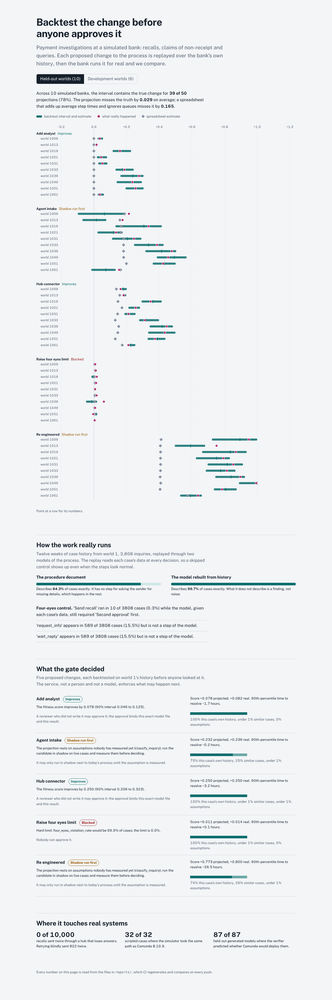

# process-fitness-loop

**Backtest a process change on the bank's own history before anyone approves it, and prove the backtest right.**

A forward-deployed engineering kit for the first months of an agentic-orchestration engagement at a bank: from the first process file to a workflow running on Camunda 8, with an improvement loop whose proposals are scored by a weighted-KPI fitness function, backtested on recorded cases, gated by four eyes and deployed through the Camunda REST API. It is built around one process from my own background, **inbound payment investigations** (camt.056 recalls, camt.027 claims of non-receipt, MT199 queries), and it is Java 21 and React.

[](https://github.com/manojrevenkar12-web/process-fitness-loop/actions/workflows/ci.yml)



## Results

Every number below is written by `pfl report` from files in `reports/`; CI regenerates the dev-world numbers on every push and fails if they differ, and runs the engine numbers against a real Camunda 8.10 cluster.

<!-- results:start -->
| Measure | Result | Source |
|---|---|---|
| Backtest error on the fitness-score change, held-out worlds | **0.029** (naive spreadsheet estimate: 0.165) | `reports/backtest-heldout.json`, 10 worlds |
| 90% interval contains the true change, held-out worlds | **78%** of proposals | `reports/backtest-heldout.json` |
| ... for the changes the gate lets a reviewer approve | **19 of 20** | `reports/backtest-heldout.json` |
| Verdicts that hold against the truth, held-out worlds | **50 of 50** | `reports/backtest-heldout.json` |
| Backtest error on the fitness-score change, dev worlds | **0.014** (naive spreadsheet estimate: 0.173) | `reports/backtest-dev.json`, 6 worlds |
| 90% interval contains the true change, dev worlds | **93%** of proposals | `reports/backtest-dev.json` |
| ... for the changes the gate lets a reviewer approve | **12 of 12** | `reports/backtest-dev.json` |
| Verdicts that hold against the truth, dev worlds | **30 of 30** | `reports/backtest-dev.json` |
| Recalls sent twice under hub timeouts | **0 of 10000** (blind retry: 822) | `reports/hub-reliability.json` |
| Simulator path equals Camunda 8.10.9 path | **32 of 32** cases | `reports/engine-equivalence.json` |
| Verifier predicts the engine's deploy decision, held-out mutants | **87 of 87** | `reports/verifier-vs-engine.json` |
| Verifier predicts the engine's deploy decision, dev mutants | **64 of 64** | `reports/verifier-vs-engine.json` |
| ... on the first engine run, before six rules were reclassified | 60 of 87 held-out | `reports/verifier-vs-engine-first-run.json` |
<!-- results:end -->

What the rows mean:

- **Backtest error.** In every simulated bank (a *world*), the backtester sees twelve weeks of exported history and projects the change in fitness score for five proposals. Then the world runs each proposal for real over the same inquiries. The error is the gap between the two. The *naive spreadsheet estimate* adds up average step times along each case's path, with nobody waiting for a colleague and nobody going home at six.
- **Held-out worlds** were pinned by hash (`reports/heldout-pin.json`) before the backtester was finished and were run once, after. The dev worlds are where the method was developed; their numbers are better, as you would expect.
- **Verdicts that hold.** An *Improves* that really improved, a *Blocked* that really crosses a hard limit, a *Shadow run first* on a change that really crosses none.
- **The verifier rows** compare, mutant by mutant, whether the verifier says a generated model will deploy with whether Camunda 8.10.9 deploys it. The first run disagreed on 27 of 87 held-out mutants, all in one direction; see [What the engine taught me](#what-the-engine-taught-me).

## Why this exists

Camunda describes ProcessOS publicly as four agents (discover, design, build, optimise), a *fitness function* that is "a weighted scoring model built from the KPIs that matter to the process", and an improvement loop that backtests a proposed change "against historical process data" and puts it in front of a person before it reaches production. Its forward-deployed engineers own the path from the first process file to a working, improving system at an enterprise customer, write connectors to legacy systems and custom agents where the defaults do not fit, and leave a playbook behind.

The hard question in that loop is not generating a diagram. It is: **when the system says a change will cut the 90th-percentile resolution time by 26 hours, how do you know, and how does the customer's risk officer know?** This repository answers it for one process and shows the answer holding on banks it has never seen.

None of this is Camunda code or affiliated with Camunda. It runs on Camunda 8 through its public REST API.

## The loop, end to end

| Step | What happens | Command |
|---|---|---|
| 1. First process file | A generated BPMN file is checked before anyone deploys it: will the engine refuse it, can every run finish, what would a reader misunderstand. Then it is written out as numbered steps for the business lead, from the model alone. | `pfl verify FILE --vars amount,currency`, `pfl explain FILE` |
| 2. How work really runs | Data-aware token replay of the recorded history against the documented process and the discovered one. Gateways read each case's data, so a recall above the four-eyes limit sent without its approval does not "fit". | `pfl conformance FILE HISTORY` |
| 3. Fitness function | Weighted KPIs from `config/fitness.json` (90th-percentile resolution time, SLA breaches, cost per case, person touches), scored from today's baseline (0) to the targets (1), with hard limits that block a change whatever its score: the four-eyes control, open cases. | in `pfl backtest` |
| 4. Backtest | Each proposal is replayed over the recorded cases with paired random numbers; every simulated step comes from the case's own history, then similar cases, then a declared assumption with its source. Team sizes come from the history, not the roster. | `pfl backtest hub-connector` |
| 5. Gate | Only an *Improves* can be approved, never by its author; a change resting on an unmeasured assumption can only run in shadow; the approval binds the model file and backtest result by hash; every decision goes to a hash-chained log. | `POST /api/proposals/{id}/decision` |
| 6. Deploy and work | An approved model is deployed through `POST /v2/deployments`; the job worker runs the connector for the legacy hub and the other service tasks. | `POST /api/proposals/{id}/deploy`, `pfl worker` |

## Quick start

Java 21 and Maven; Node 22 for the dashboard.

```bash
mvn -q verify                                   # 87 unit tests across four modules
alias pfl='java -cp "pfl-service/target/*:pfl-service/target/lib/*" io.github.mkp.pfl.service.Main'
mvn -q package -DskipTests

pfl verify processes/payment-investigation-to-be.bpmn --vars caseId,amount,currency,channel
pfl explain processes/payment-investigation-to-be.bpmn
pfl conformance processes/payment-investigation-as-documented.bpmn data/history-sample.jsonl
pfl backtest hub-connector
pfl serve                                        # API on :8790

# regenerate the evidence
mvn -q -pl pfl-world exec:java -Dexec.args="dev ."      # six dev worlds, about 90 s
pfl report                                       # reports/results.json and the table above

# a local engagement: Camunda 8.10 on H2, the simulated hub and the worker
docker compose -f deploy/docker-compose.yml up --build

cd dashboard && npm ci && npm run dev
```

## How the backtest is scored

`pfl-world` is a simulated bank with hidden parameters per seed: arrival volumes, the mix of inquiry types, step durations, how often an inquiry arrives without its UETR, how long senders take to answer, a hidden per-case complexity, how many analysts are really at work (the roster says seven; some worlds have six), when the team leads look at their queue, and an undocumented habit of sending urgent large recalls before the second approval. It runs today's process and exports what a case tool would record: no hidden attribute leaves the module, and a test fails the build if `pfl-core`, `pfl-hub` or `pfl-service` ever refer to it.

For each world and proposal, the report holds the backtest's estimate and interval, the true change, the naive estimate and whether the interval covered the truth (`reports/backtest-dev.json`, `reports/backtest-heldout.json`).

On the held-out worlds:

| Proposal | Verdict in every world | Interval covers the truth | Error, backtest | Error, spreadsheet |
|---|---|---|---|---|
| Add one analyst | Improves | 10 of 10 | 0.006 | 0.130 |
| Look up payments through the hub connector | Improves | 9 of 10 | 0.010 | 0.144 |
| Let an agent classify inquiries | Shadow run first | 7 of 10 | 0.064 | 0.131 |
| Raise the four-eyes limit to 25,000 | Blocked | 4 of 10 | 0.014 | 0.011 |
| Full re-engineering | Shadow run first | 9 of 10 | 0.050 | 0.409 |

The misses are where you would want them. The agent proposal rests on an assumption nobody has measured (that the agent decides the way analysts did); its projection is wide and sometimes still wrong, which is why the gate only lets it run in shadow. The four-eyes proposal is blocked in every world, and its tiny effect lands outside a narrow interval because the team leads' batching habit is invisible in the history. For the two changes the gate would let a reviewer approve, the interval held in 19 of 20 worlds.

The spreadsheet estimate says adding an analyst changes nothing (it has no queues) and gets the re-engineered process wrong by 0.41 on a 0-to-1 scale.

## What the history taught me

The first backtester trusted the roster. In the dev worlds where one analyst was absent, it under-projected the gains, the hub connector's by half and an extra analyst's by four-fifths, because every queue in the real bank was longer than in its simulation. The fix was to read the team size from the history (the median daily peak of person steps in progress at once) and to tell the reviewer when the roster and the history disagree. That finding is the kind an FDE brings back from the field: the plan and the floor are different.

## What the engine taught me

The verifier started with twenty-one rules it called deploy errors, written from my reading of BPMN and Zeebe. The first CI run against Camunda 8.10.9 deployed every mutant of six of them: conditions on flows leaving a task, gateway flows with neither condition nor default, a condition on a default flow, an undefined error reference, a start event with an incoming flow and an end event with an outgoing one. All 27 disagreements went the same way. Those rules are now design or behaviour warnings, with the engine's acceptance written into the message, and agreement is 87 of 87 on the held-out mutants. The held-out mutants come from two other models, but the same operator families, so they show that the rules carry over to new files, not that the operators would. The first run is kept in `reports/verifier-vs-engine-first-run.json`.

## Where it touches real systems

- **Legacy hub connector.** The PH/9 hub speaks fixed-width records, expires sessions, sheds load with 503s and sometimes accepts a recall and loses the answer. It does not de-duplicate. The client asks the hub for a recall on file under the step's client reference before it sends one, so retries and job re-activations never recall the money twice. Over 10,000 recalls with 8% lost answers: 0 sent twice; a client that retries blindly sent 822 twice. Element templates for Modeler are in `element-templates/`.
- **Camunda 8 REST client and job worker.** JDK HTTP and Jackson only: inside a bank every dependency is a security review. Long-polling activation, completion with the 8.10 job lease token, BPMN errors and failures with back-off, one virtual-thread poller per job type.
- **Engine equivalence.** CI starts `camunda/camunda:8.10.9` with H2 secondary storage, deploys the re-engineered process, runs 32 scripted cases that reach every element through the real worker and a hub losing 25% of its answers, and compares each case's element-instance path with the simulator's. 32 of 32 match, and every recall case reached the hub exactly once.

## Invariants

1. Nothing that ships can see the truth: `pfl-world` is a separate module and a test scans the others.
2. Every simulated number has a source, and the result says how much came from history and how much from assumptions.
3. Hard limits block; a weighted score never buys its way past the four-eyes control.
4. People decide: no approval by the author, no approval without a backtest, no deployment of a file that changed since its approval.
5. Settings live in `config/`; numbers in this README come from `reports/` through `pfl report`.
6. The dev-world reports are reproducible to the byte (`StrictMath`, sorted JSON, keyed random draws); CI checks it.

## Layout

```
pfl-core      BPMN parser, FEEL subset, verifier, explainer, event log, token replay, fitness function, simulator, backtester
pfl-world     the hidden ground-truth bank and the evaluation (nothing depends on it)
pfl-hub       PH/9 hub protocol, simulator and exactly-once client, Camunda REST client, job worker
pfl-service   pfl command line, HTTP API, four-eyes decisions, scripted engine scenario, mutation corpus
dashboard     React + Framer Motion, reads reports/
processes/    as documented, as is (discovered), to be (re-engineered)
proposals/    five proposals with their evidence and assumptions
config/       fitness function, staffing, worlds, service
docs/         playbook, architecture decisions
```

## Limits

- The bank is simulated. The method is what transfers; the numbers describe these worlds.
- The FEEL subset covers comparisons, arithmetic and boolean logic; anything else is reported as unsupported and not simulated.
- The verifier models flat processes: no sub-processes, call activities, event-based or inclusive gateways.
- The intake agent here is scripted. A real one plugs in behind the same job type; the gate is built for exactly that case, where decisions are an unmeasured assumption until a shadow run measures them.

See [REPORT.md](REPORT.md) for the method in more detail and [docs/playbook.md](docs/playbook.md) for the engagement playbook.

## Licence

Apache 2.0.
